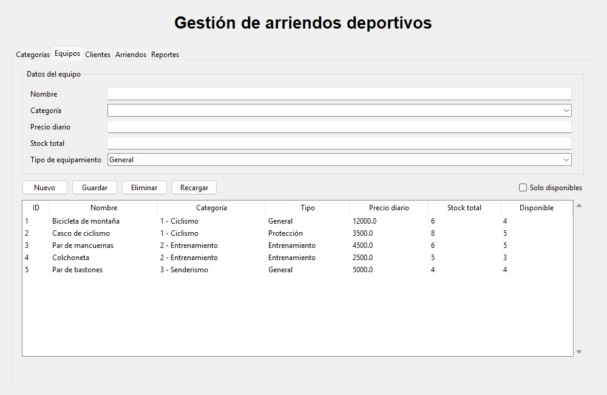
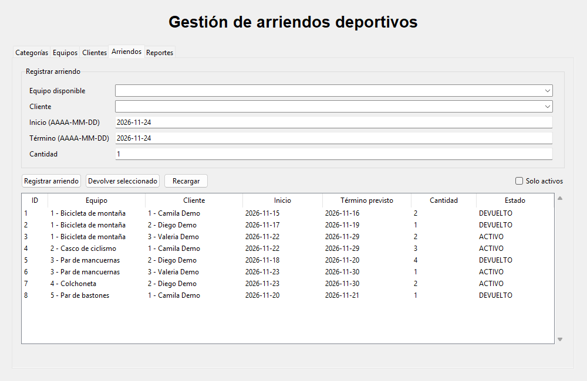
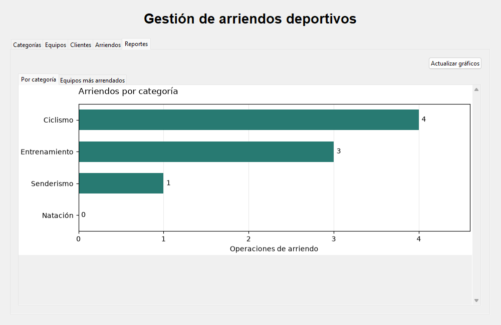
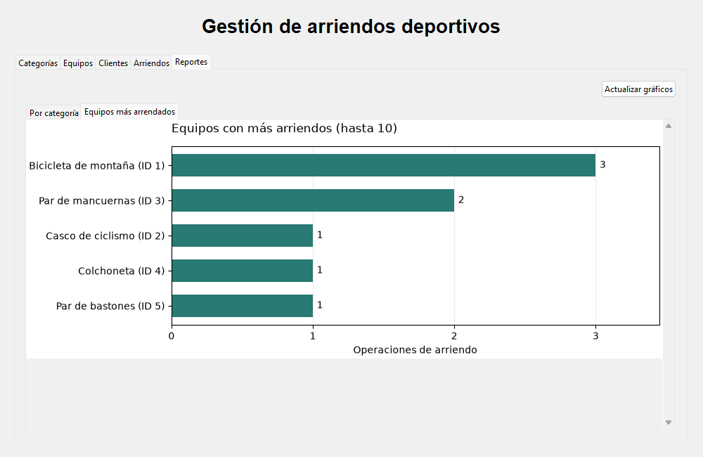

# Sistema de gestión de arriendos deportivos

Proyecto final de Programación II de Simón Pedro Millanguir Zambrano y Benjamín Varela. La aplicación de escritorio usa Tkinter, SQLAlchemy ORM, SQLite y Matplotlib.

## Instalación y ejecución

Desde la raíz del proyecto, con Python 3.10 o posterior y Tkinter disponible, ejecuta `python -m pip install -r requirements.txt`. Puedes verificar Tkinter con `python -m tkinter`, que abre una ventana de prueba.

```sh
python main.py
```

La aplicación crea `arriendos.db` en la raíz del proyecto cuando se abre por primera vez. Las siguientes sesiones reutilizan esa base.

### Base de ejemplo

```sh
python datos_ejemplo.py
python main.py --base arriendos-ejemplo.db
```

El generador crea una base independiente con cuatro categorías, cinco equipos, tres clientes ficticios y ocho operaciones de arriendo. Incluye arriendos activos y devueltos y una categoría sin operaciones. El generador pide una ruta diferente si el archivo de destino ya existe. Usa `--base otra-ruta.db` en ambos comandos para trabajar con otro archivo.

## Cómo estudiar el código

1. Empieza por `main.py` para ver cómo se abre la base y se conectan las pestañas. `interfaz/panel.py` concentra los formularios, la tabla y los mensajes que comparten las vistas de gestión.
2. Sigue un arriendo desde `interfaz/arriendos.py` a `CRUD/arriendo.py`. Las operaciones de escritura usan `transaccion` de `CRUD/_comun.py` para confirmar o revertir juntos el arriendo y su cambio de stock.
3. Abre `modelos.py` para ubicar las entidades y sus relaciones. Para seguir la creación de un equipo, pasa de `CRUD/equipo.py` a `CRUD/fabrica_equipo.py` y vuelve a las clases concretas en `modelos.py`.
4. Revisa `reportes.py` para ver las consultas agregadas y el dibujo de barras. `interfaz/reportes.py` incrusta las figuras en Tkinter.
5. Usa `tests/test_sistema.py` y `tests/test_interfaz.py` para comprobar cómo se comporta el sistema con datos válidos y qué sucede cuando rechaza una operación.

## Modelo persistente

| Entidad | Datos principales | Relaciones |
| --- | --- | --- |
| `Categoria` | ID, nombre único y descripción | Una categoría contiene varios equipos |
| `Equipo` | ID, nombre, categoría, tipo, precio diario, stock total y disponible | Pertenece a una categoría y puede tener varios arriendos |
| `Cliente` | ID, nombre, correo único y teléfono | Un cliente puede tener varios arriendos |
| `Arriendo` | ID, equipo, cliente, fechas, cantidad y estado | Cada operación corresponde a un equipo y a un cliente |

Las claves foráneas de SQLite protegen las relaciones. El CRUD valida los datos y comunica por qué se rechaza una operación. El registro de un arriendo guarda el estado `ACTIVO` y descuenta sus unidades en una transacción. La devolución completa restaura las unidades y cambia el estado a `DEVUELTO` en otra transacción. El historial protege los equipos y clientes vinculados frente a la eliminación.

## Operaciones en la interfaz

- **Categorías**, **Equipos** y **Clientes** permiten crear, consultar, actualizar y eliminar registros. **Equipos** incluye un filtro por stock disponible.
- **Arriendos** permite registrar un arriendo, devolverlo y consultar el historial. El filtro **Solo activos** muestra las devoluciones pendientes.
- **Reportes** muestra los dos gráficos calculados con los registros de la base abierta.

## Reportes de arriendos

El botón **Actualizar gráficos** vuelve a consultar la base abierta.

- **Arriendos por categoría** muestra todas las categorías registradas, incluidas las que tienen cero operaciones. Usa la categoría actual del equipo asociado al arriendo.
- **Equipos con más arriendos** muestra hasta diez equipos con operaciones, ordenados de mayor a menor. Cada equipo se identifica por su nombre e ID.

Ambos gráficos incluyen arriendos activos y devueltos. Cada fila de `arriendos` cuenta como una operación, independientemente de las unidades de `cantidad`. Los gráficos muestran los datos guardados en SQLite y tienen un mensaje para los casos sin datos.

## Factory Method para equipamiento

En la pestaña **Equipos**, selecciona el **Tipo de equipamiento** al crear un equipo. La tabla muestra el tipo guardado y el formulario lo presenta como solo lectura al editar un equipo existente.

`CRUD.equipo.crear_equipo` acepta el argumento opcional `tipo` con los valores `general` (predeterminado), `proteccion` y `entrenamiento`. Por ejemplo, `crear_equipo(sesion, "Casco", categoria_id, 3500, 10, tipo="proteccion")` devuelve un `EquipoProteccion` persistido.

`CreadorEquipo` centraliza la validación del nombre, el precio y el stock. Su método `_crear_producto` permite que cada creador concreto construya la clase ORM de su tipo. Para agregar uno se puede definir un nuevo producto y su creador con las mismas validaciones y el mismo flujo de guardado.

SQLAlchemy guarda los tipos en la tabla `equipos` y reconstruye la clase correspondiente cuando los vuelve a leer. `categoria_id` sigue identificando la categoría que se usa en los reportes. Al abrir una base anterior, se agrega la columna `tipo` con el valor inicial `general` para sus equipos existentes.

## Capturas de la aplicación

Las capturas se tomaron con la base de ejemplo generada por el proyecto.









## Pruebas y demostración

```sh
python -m unittest discover -v
```

Las pruebas usan bases temporales. Cubren el CRUD, las restricciones de registros vinculados, las validaciones y la reversión de operaciones, los tipos persistentes, la migración de bases anteriores, el generador de ejemplo y el conteo en ambos gráficos. La prueba Tkinter recorre las pestañas y verifica los mensajes de rechazo. Requiere un entorno gráfico.

Para repetir la demostración desde una base vacía, abre `python main.py --base demostracion.db` con un nombre de archivo que aún no exista y recorre estos pasos.

| Paso | Acción | Resultado esperado |
| --- | --- | --- |
| 1 | Crear una categoría y un equipo con stock total de 5 | Disponible 5 |
| 2 | Crear un cliente y arrendar 2 unidades | Disponible 3, arriendo `ACTIVO` |
| 3 | Intentar arrendar 4 unidades adicionales | Operación rechazada, disponible 3 |
| 4 | Seleccionar el primer arriendo y devolverlo | Disponible 5, arriendo `DEVUELTO` |
| 5 | Intentar devolverlo nuevamente | Operación rechazada, disponible 5 |
| 6 | Cerrar, reabrir la misma base y seleccionar **Reportes** | El historial y el stock se conservan. Cada gráfico muestra una operación |

## Fuentes consultadas

- Documentación de Python para ventanas, eventos y widgets de interfaz. [Tkinter](https://docs.python.org/3/library/tkinter.html)
- Ejemplo oficial para incrustar figuras en una ventana Tkinter. [Matplotlib: Embed in Tk](https://matplotlib.org/stable/gallery/user_interfaces/embedding_in_tk_sgskip.html)
- Referencia de herencia de una sola tabla para persistir los tipos de equipo. [SQLAlchemy: Single Table Inheritance](https://docs.sqlalchemy.org/en/20/orm/inheritance.html#single-table-inheritance)
- Catálogo original de patrones de Gamma, Helm, Johnson y Vlissides, capítulo de patrones creacionales, sección Factory Method. [Design Patterns: Elements of Reusable Object-Oriented Software](https://www.informit.com/store/design-patterns-elements-of-reusable-object-oriented-9780201633610)
